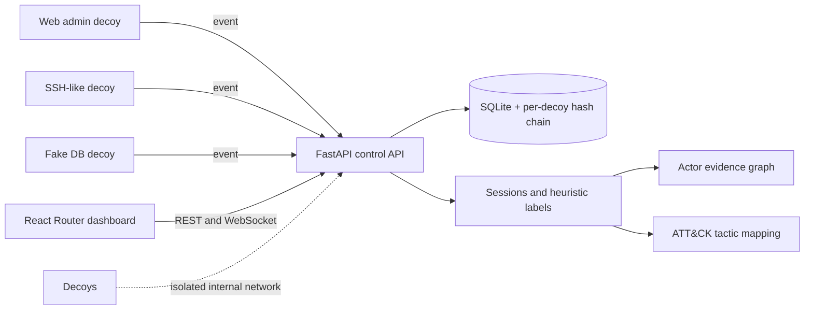

# GhostNet

GhostNet is a defensive deception lab. Its low-interaction decoys use fake credentials and records, emit privacy-minimized events, and run on an internal Docker network with loopback-only published ports. The backend links sessions, applies transparent behavior rules, maps auditable ATT&CK categories, and presents the result in a React dashboard.

## Safety first

Use only on systems you own or are authorized to operate. Decoy containers have no direct external route, no host mounts, no Docker socket, no privileges, dropped capabilities, read-only roots, and resource limits. `python -m ghostnet.orchestrator.lifecycle up` validates the Compose file and runtime state before starting decoys. Stop the lab with `python -m ghostnet.orchestrator.lifecycle down`.

The services are deliberately inert: SSH-like prompts do not implement SSH or a shell; fake database commands do not execute SQL; no decoy connects back to a client. All login data is reduced to lengths and keyed hashes before storage. Do not put real credentials in this lab.

## Run

```powershell
uv sync --extra dev
uv run uvicorn ghostnet.api.main:app --reload
```

In another terminal, run the contained decoy network:

```powershell
uv run python -m ghostnet.orchestrator.lifecycle up
```

Start the React dashboard from `dashboard` with `npm ci` and `npm run dev`. The web decoy is bound only to `127.0.0.1:8081`; SSH-like and DB-like decoys use `127.0.0.1:2222` and `127.0.0.1:5433`. These are for the scripted benign test actors only. To generate sample data, first start the API and decoys, then run `uv run python testactors/local_demo.py`. Open the dashboard at `http://127.0.0.1:5173`.

The API exposes `/fleet`, `/events`, `/sessions`, `/actors`, `/graph`, and `/attack/heatmap`; `/live` streams new events over WebSocket. `/adapt/propose` returns a safe allowlisted suggestion, and `/adapt/approve` records analyst decisions without deploying changes. The dashboard panic control requires typing `STOP GHOSTNET`. To restart after a panic, use `POST /admin/panic/reset` with `{"confirmation":"RESET GHOSTNET"}` and restart the Compose stack.

## Architecture



The API and dashboard live on the control network. Decoys attach only to the Docker `internal` deception network and are separately published on loopback for local training. The containment command checks Compose configuration before it starts containers, then inspects the Docker daemon when available.

## Test and validate

```powershell
uv run pytest
uv run python -m ghostnet.orchestrator.containment_check
cd dashboard
npm ci
npm run build
```

## Structure

- `ghostnet/decoys`: inert web, SSH-like, and database-like services.
- `ghostnet/sensors`: event schema, source hashing, and tamper-evident hash chain.
- `ghostnet/pipeline`: session summaries, behavior classification, actor graph, ATT&CK rules.
- `ghostnet/adapt`: policy-gated, auditable safe actions.
- `ghostnet/orchestrator`: fail-closed Compose checks and lifecycle commands.
- `ghostnet/storage` and `ghostnet/api`: local event store and dashboard APIs.
- `rules`: explicit ATT&CK mapping and action allowlist.
- `testactors`: harmless lab-only scanner and login guesser.

This is a local learning build, not a production honeypot. It does not ship a real shell, offensive tools, high-interaction services, or public-network deployment configuration.
