<p align="center">
  
</p>

<h1 align="center">GhostNet
</h1>

**A contained deception lab that turns fake services into high-signal security telemetry.**

GhostNet runs low-interaction decoys (a web admin panel, an SSH-like prompt, a fake database) on an isolated Docker network. Anything that touches them is suspicious by definition. The backend records what happened with minimal personal data, links events into sessions, labels behavior with transparent rules, maps it to MITRE ATT&CK tactics, and shows it all in a React dashboard.

---

## The problem

- **Alert noise.** Normal monitoring buries analysts in events that might be bad. A decoy has no legitimate users, so any interaction is worth looking at.
- **Honeypots are risky to run.** A badly built one can become a foothold into your own network, execute attacker input, or hoard real credentials. Many teams avoid them because of that.
- **Logs without context.** Isolated login attempts and port scans say little. Linking them into sessions and actors, and tagging them with ATT&CK categories, turns noise into a story an analyst can use.
- **Black-box detection.** Opaque scoring is hard to trust and harder to audit. Analysts need to see *why* something was labeled the way it was.

## What GhostNet does

| Area | What it does |
|------|--------------|
| **Decoys** | Inert web, SSH-like and database-like services. They don't implement a real shell or SQL engine and never connect back to a client. |
| **Containment** | Decoy containers have no direct external route, no host mounts, no Docker socket, no privileges, dropped capabilities, read-only roots and resource limits. Published ports are loopback-only. |
| **Privacy-minimized events** | Login data is reduced to lengths and keyed hashes before storage. Real credentials never land in the database. |
| **Tamper evidence** | Each decoy's events are stored in a hash chain, so edited or deleted records are detectable. |
| **Sessions and behavior** | Events are grouped into sessions and labeled by heuristic rules you can read. |
| **Actor graph** | Evidence is linked into an actor graph to show related activity. |
| **ATT&CK mapping** | Explicit, auditable mapping from observed behavior to ATT&CK tactics, with a heatmap. |
| **Safe adaptation** | The system can *propose* allowlisted actions. Analysts approve or reject, and nothing is deployed automatically. |
| **Kill switch** | A panic control stops the lab and requires typing `STOP GHOSTNET` to trigger. |
| **Fail-closed startup** | The lifecycle command validates the Compose file and runtime state before starting any decoy. |

## Why it matters

- **High signal, low noise.** Decoy hits are rare and meaningful, which cuts the false-positive burden of traditional detection.
- **Safe by construction.** Isolation, dropped privileges and inert services mean you can learn from attacker behavior without handing them anything real.
- **Privacy-minimized.** The lab observes behavior (lengths, hashed values, timing) rather than collecting secrets.
- **Auditable.** Rule-based labels, explicit ATT&CK mappings, a hash-chained event log and approval-gated actions make every conclusion traceable.
- **A good training sandbox.** Scripted benign test actors let you generate sample data and see the full detection pipeline without touching a real network.

## How it works

The decoys emit privacy-minimized events into the control API. Events are tamper-evident, grouped into sessions, and labeled with readable behavior rules before analysts inspect the evidence and any proposed response.

```mermaid
flowchart LR
  A[Benign lab actor] --> B[Inert decoys on isolated network]
  B --> C[Privacy-minimized event]
  C --> D[FastAPI control API]
  D --> E[SQLite per-decoy hash chain]
  E --> F[Session correlation and behavior rules]
  F --> G[Actor evidence graph and ATT&CK mapping]
  G --> H[React dashboard via REST and WebSocket]
  H --> I[Allowlisted response proposal]
  I --> J[Analyst approval recorded]
```



Decoys are published only on loopback for the local test actors. They do not run a real shell or SQL engine, and analyst approval records a decision without deploying changes. Startup validates the Compose configuration and runtime containment before services are launched.
## Getting started

**Requirements:** Python 3.11+, [uv](https://docs.astral.sh/uv/), Node.js 20+, Docker

```bash
uv sync --extra dev
uv run uvicorn ghostnet.api.main:app --reload
```

In another terminal, start the contained decoy network:

```bash
uv run python -m ghostnet.orchestrator.lifecycle up
```

Start the dashboard:

```bash
cd dashboard
npm ci
npm run dev
```

Generate sample data (API and decoys must be running):

```bash
uv run python testactors/local_demo.py
```

Open <http://127.0.0.1:5173>. Local decoy ports, for the scripted test actors only:

| Decoy | Address |
|-------|---------|
| Web admin | `127.0.0.1:8081` |
| SSH-like | `127.0.0.1:2222` |
| DB-like | `127.0.0.1:5433` |

Stop the lab:

```bash
uv run python -m ghostnet.orchestrator.lifecycle down
```

### API

| Endpoint | Purpose |
|----------|---------|
| `/fleet` | Decoy status |
| `/events` | Recorded events |
| `/sessions` | Linked sessions |
| `/actors` | Actor profiles |
| `/graph` | Actor evidence graph |
| `/attack/heatmap` | ATT&CK tactic heatmap |
| `/live` | WebSocket stream of new events |
| `/adapt/propose` | Safe, allowlisted suggestion |
| `/adapt/approve` | Records an analyst decision (does not deploy anything) |

After a panic stop, call `POST /admin/panic/reset` with `{"confirmation":"RESET GHOSTNET"}` and restart the Compose stack.

### Test and validate

```bash
uv run pytest
uv run python -m ghostnet.orchestrator.containment_check
cd dashboard && npm ci && npm run build
```

## Project layout

```
ghostnet/
  decoys/         inert web, SSH-like and database-like services
  sensors/        event schema, source hashing, tamper-evident hash chain
  pipeline/       sessions, behavior classification, actor graph, ATT&CK rules
  adapt/          policy-gated, auditable safe actions
  orchestrator/   fail-closed Compose checks and lifecycle commands
  storage/ api/   local event store and dashboard APIs
dashboard/        React Router UI
rules/            explicit ATT&CK mapping and action allowlist
testactors/       harmless lab-only scanner and login guesser
tests/
```

## Safety

- Use only on systems you own or are authorized to operate.
- The services are deliberately inert: no real SSH or shell, no SQL execution, no connections back to clients.
- Never put real credentials into this lab.
- Containment is checked before startup and the stack fails closed if the checks don't pass.

## Scope and limitations

This is a local learning build, not a production honeypot. It ships no real shell, no offensive tooling, no high-interaction services and no public-network deployment configuration. Behavior labels are heuristics, not ground truth, and ATT&CK mappings are tactic-level only.

## Author

**Nihal Machhi** · [GitHub](https://github.com/nihalmachhi)

