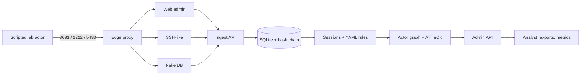

<p align="center">
  
</p>

<h1 align="center">GhostNet</h1>

<p align="center">
  <a href="https://github.com/nihalmachhi/GhostNet/actions/workflows/ci.yml"></a>
  <a href="LICENSE"></a>
  
  
</p>

**A contained deception lab that turns fake services into high-signal security telemetry.**

Live site: https://nihalmachhi.github.io/GhostNet/

GhostNet runs low-interaction decoys (a web admin panel, an SSH-like prompt and a
fake database) on an isolated Docker network. Anything that touches them is
suspicious by definition. The backend records what happened with minimal personal
data, links events into sessions, labels behavior with readable YAML rules, maps
it to MITRE ATT&CK, and exposes the evidence through an authenticated admin API,
exports and a static showcase site.

> **Synthetic data.** The evaluation report is generated from hand-built fixtures.
> It verifies the pipeline; it is not evidence of real-world detection quality.

---

## Why this exists

- **Alert noise.** Normal monitoring buries analysts in maybe-bad events. A decoy
  has no legitimate users, so any interaction is worth looking at.
- **Honeypots are risky to run.** A badly built one can become a foothold, execute
  attacker input or hoard real credentials. GhostNet is inert and contained by
  construction.
- **Logs without context.** A login attempt alone says little. Sessions, actors and
  ATT&CK mappings turn it into a story an analyst can use.
- **Black-box detection.** Opaque scoring is hard to trust. Every GhostNet label
  names the rule that fired and the evidence it used.

## What it does

| Area | Implementation |
|---|---|
| **Inert decoys** | Web admin, SSH-like and DB-like services. No real shell, SSH daemon or SQL engine. |
| **Containment** | `internal: true` deception network, loopback-only published ports, non-root, read-only root, dropped capabilities, no host mounts, pid/memory/CPU limits. |
| **Split control plane** | Decoys reach only the ingest API. The admin API lives on a separate control network and is never dual-homed. |
| **Privacy-minimized events** | Keyed hashes, lengths and coarse classes. Raw credentials and raw addresses never land in storage. |
| **Tamper evidence** | Per-decoy HMAC-SHA256 hash chain written under `BEGIN IMMEDIATE`, with signed head checkpoints. |
| **Sessions and rules** | Idle-split sessions, ordered YAML classification, explicit rule id, score and evidence. |
| **Actor graph** | Sessions linked by shared canary evidence, then by hashed source. |
| **ATT&CK mapping** | Observable tactic/technique rows plus a heatmap and Navigator export. |
| **Policy-gated adaptation** | Epsilon-greedy proposals from a static allowlist. Analysts approve or reject; nothing deploys. |
| **Panic switch** | Authenticated kill switch requiring `STOP GHOSTNET`; decoys poll and exit. |
| **Fail-closed startup** | Static Compose checks run before start; runtime checks stop the stack if containment regresses. |
| **Exports and metrics** | ATT&CK Navigator, STIX 2.1, CSV/JSONL, signed checkpoint, Prometheus text gauges. |

## How it works



The edge proxy is the only dual-homed service and forwards only the three decoy
ports. The ingest API is isolated on the deception network. The admin API is
published on loopback and cannot be reached from the deception network.

Read [docs/architecture.md](docs/architecture.md) for the trust boundaries and
[docs/threat-model.md](docs/threat-model.md) for the adversarial assumptions.

## Quick start

**Requirements:** Python 3.11+, [uv](https://docs.astral.sh/uv/), Docker Compose v2,
Node.js 22 for the site.

```bash
uv sync --extra dev
cp .env.example .env
# put four different 32-byte hex secrets in .env
uv run python -m ghostnet.orchestrator.lifecycle up
uv run python testactors/local_demo.py
```

Open the admin API at <http://127.0.0.1:8000>. Loopback decoy ports for the
scripted actors:

| Decoy | Address |
|---|---|
| Web admin | `127.0.0.1:8081` |
| SSH-like | `127.0.0.1:2222` |
| DB-like | `127.0.0.1:5433` |

The site is a static showcase:

```bash
cd site
npm ci
npm run dev
```

Stop the lab:

```bash
uv run python -m ghostnet.orchestrator.lifecycle down
```

If Docker is unavailable, the static checks still run:

```bash
uv run python -c "from ghostnet.orchestrator.containment_check import check_compose_config; print(check_compose_config('docker-compose.yml'))"
```

## API

All admin routes require `X-Admin-Token`. The ingest API is internal and uses a
per-decoy HMAC token.

| Endpoint | Purpose |
|---|---|
| `/fleet` | Decoy status, event count, panic state, containment summary |
| `/events`, `/events/{id}` | Retained events |
| `/sessions`, `/sessions/{id}` | Derived sessions with labels and ATT&CK rows |
| `/actors`, `/graph` | Linked actors and evidence graph |
| `/attack/heatmap` | Tactic counts |
| `/adapt/propose`, `/adapt/approve` | TTL-bound proposal and recorded decision |
| `/panic`, `/admin/panic/reset` | Kill switch and reset |
| `/integrity`, `/checkpoint` | Chain verification and signed heads |
| `/metrics` | Prometheus text gauges |
| `/live` | Authenticated WebSocket event stream |

See [docs/api.md](docs/api.md) for shapes, limits and status codes.

## Verify it

```bash
uv run ruff check .
uv run ruff format --check .
uv run mypy src
uv run pytest -q --cov=ghostnet --cov-report=term-missing
uv run python -m ghostnet.orchestrator.containment_check
uv run python -m ghostnet.evaluation

cd site
npm ci
npm run lint
npm run typecheck
npm test -- --run
npm run build
```

The Python suite enforces 80% branch coverage. The generated report lives at
[docs/evaluation.md](docs/evaluation.md) and is labelled synthetic. The site
simulator is tested against a parity fixture generated from the Python pipeline.

## Project layout

```
src/ghostnet/
  core/          settings, secret validation, logging, token helpers
  decoys/        inert web, SSH-like and DB-like services
  sensors/       schema, privacy, emitter, hash chain, panic poller
  storage/       SQLite migrations and EventStore
  pipeline/      sessions, YAML rules, actor linking, graph, ATT&CK mapping
  adapt/         epsilon-greedy proposals and static allowlist
  export/        Navigator, STIX 2.1, CSV/JSONL
  admin_api/     analyst app and routers
  ingest_api/    decoy-facing app
  orchestrator/  edge proxy, lifecycle, containment checks
  adapters/      optional Cowrie-style log normalizer
  rules/         classification, ATT&CK map, action allowlist
  evaluation.py  deterministic synthetic evaluation generator
docs/            architecture, threat model, privacy, API, operations, testing
site/            React 19 + Vite static showcase and in-browser simulator
testactors/      harmless lab-only scripted actor
tests/           unit and integration tests
```

## Safety

- Use only on systems you own or are authorized to operate.
- The services are deliberately inert: no real SSH or shell, no SQL execution, no
  connections back to clients.
- Never put real credentials into this lab.
- All published ports bind loopback. The containment checker rejects public
  bindings and decoys that publish ports.
- Startup fails closed if secrets are missing, weak or placeholders.
- There is no public deployment configuration and no offensive tooling.

## Scope and limitations

This is a local learning build, not a production honeypot. It ships no
high-interaction services, no malware capture and no public deployment. Behavior
labels are heuristics, ATT&CK mappings are tactic-level, and hashed identifiers are
pseudonymous rather than anonymous. Read [docs/limitations.md](docs/limitations.md)
before drawing conclusions from the output.

## Documentation

- [Architecture](docs/architecture.md)
- [Threat model](docs/threat-model.md)
- [Privacy](docs/privacy.md)
- [API](docs/api.md)
- [Operations](docs/operations.md)
- [Testing](docs/testing.md)
- [Final QA](docs/qa.md)
- [Synthetic evaluation](docs/evaluation.md)
- [Limitations](docs/limitations.md)

## Author

**Nihal Machhi** · [GitHub](https://github.com/nihalmachhi)

## License

MIT. See [LICENSE](LICENSE).
