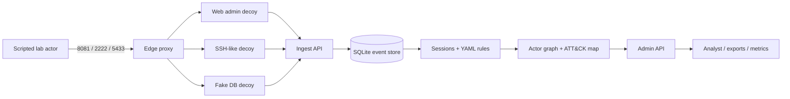

# Architecture

GhostNet separates the decoy-facing data plane from the analyst-facing control
plane. Decoys can only reach the ingest API. The admin API is never attached to
the deception network.



## Services

| Service | Network | Published host port | Responsibility |
|---|---|---|---|
| `edge` | `control`, `deception` | `127.0.0.1:8081`, `:2222`, `:5433` | Forwards only the three decoy ports. No admin route. |
| `web-admin` | `deception` | none | Inert web console, login form, canary lure. |
| `fake-ssh` | `deception` | none | Banner and credential prompt. No shell. |
| `fake-db` | `deception` | none | Banner and canned replies. No SQL engine. |
| `ingest-api` | `deception` | none | Per-decoy authenticated event intake. |
| `admin-api` | `control` | `127.0.0.1:8000` → `8001` | Analyst reads, proposals, panic, metrics. |

`control` is a normal bridge network. `deception` is `internal: true`, so the
decoys have no route to the internet or to the host beyond the edge proxy.

## Event path

1. A decoy handler receives a connection and builds a privacy-minimized event.
2. `ghostnet.sensors.emitter` hashes the source, queues the payload, and sends it
   to `ingest-api` with a per-decoy HMAC token.
3. `ingest-api` verifies the token, applies a per-decoy rate limit and an 8 KiB
   body limit, then appends the event.
4. `EventStore.append` runs under `BEGIN IMMEDIATE`, assigns `event_id`, `ts`,
   `seq`, `prev_hash` and `hash` on the server, and stores the JSON payload.
5. The admin API rebuilds sessions from retained events on read, applies the
   ordered YAML rules, maps labels to ATT&CK, and links sessions into actors.

The hash chain is per decoy. Each event's HMAC covers the previous hash and the
canonical event body. A signed checkpoint of each chain head is available at
`GET /checkpoint`.

## Module layout

```
src/ghostnet/
  core/          settings, secret validation, logging, token helpers
  decoys/        inert web, SSH-like and DB-like services
  sensors/       schema, privacy, emitter, hash chain, panic poller
  storage/       SQLite migrations and EventStore
  pipeline/      sessions, YAML rules, actor linking, graph, ATT&CK mapping
  adapt/         epsilon-greedy proposal policy and static allowlist
  export/        ATT&CK Navigator, STIX 2.1, CSV/JSONL
  admin_api/     analyst app and routers
  ingest_api/    decoy-facing app
  orchestrator/  edge proxy, lifecycle and containment checks
  adapters/      optional Cowrie-style log normalizer
  rules/         classification, ATT&CK map and action allowlist
  evaluation.py  deterministic synthetic evaluation generator
```

## Design choices

- **Read-time analysis.** Sessions and labels are derived from retained events
  instead of a second mutable projection. This keeps the stored evidence and the
  analyst view consistent and makes every label reproducible from the rule file.
- **Server-owned integrity.** Clients cannot supply `event_id`, `ts`, `seq`,
  `prev_hash` or `hash`; the schema rejects unknown fields.
- **Proposal, not action.** The bandit selects among allowlisted proposal kinds.
  Approval records a decision and never deploys a change.
- **Fail closed.** Secret validation, hash-key validation and the containment
  checker refuse to start rather than degrade silently.
